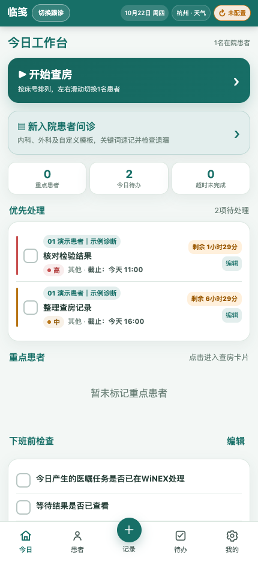
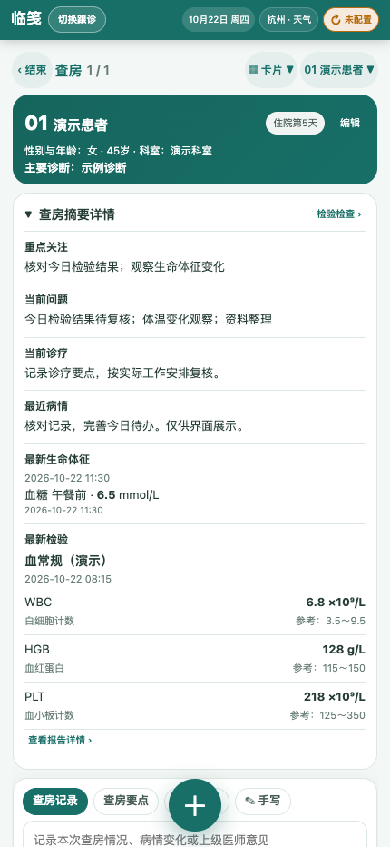
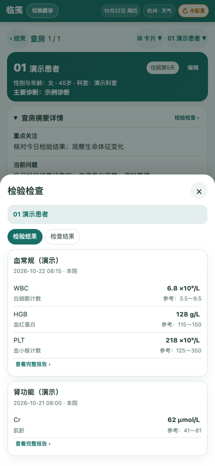
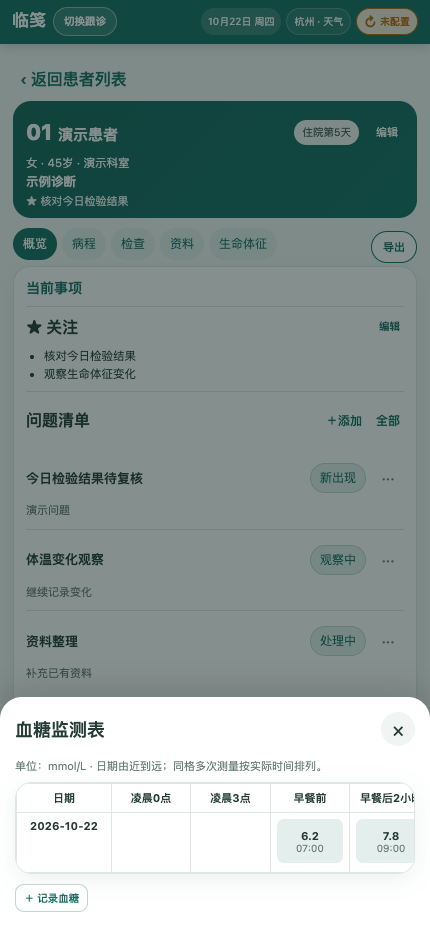
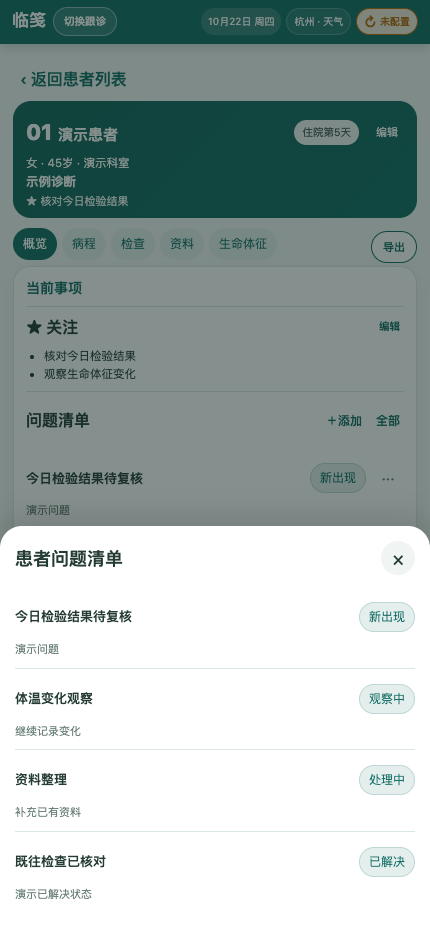
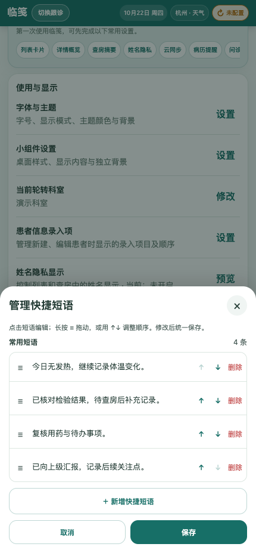
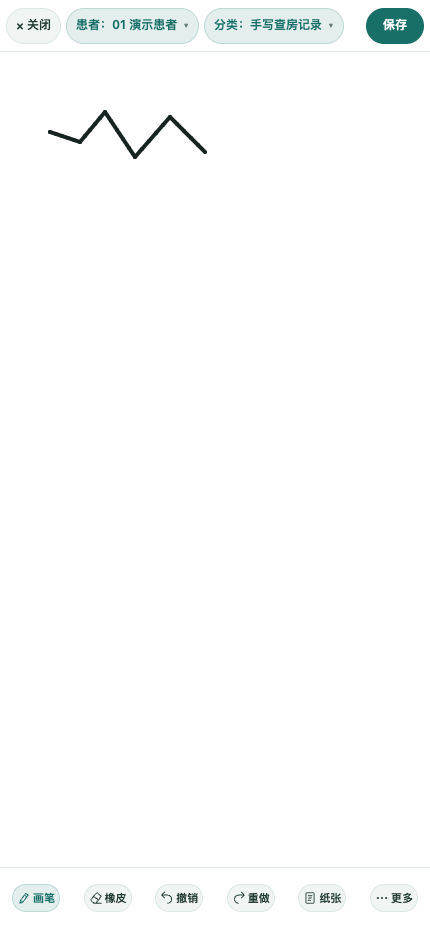
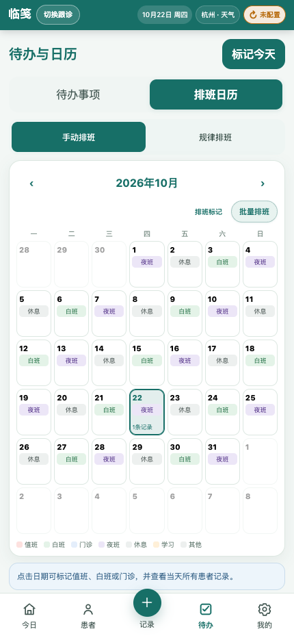

# 临笺 · Linjian

**临床查房与跟诊记录助手**

Android 当前正式版 **2.6.6** · iOS / iPadOS 已上架 App Store

[iOS App Store](https://apps.apple.com/cn/app/%E4%B8%B4%E7%AC%BA/id6800396297) · [官方网站](https://lhzspace.com/linjian/) · [Android 版本说明](https://lhzspace.com/linjian/android/) · [使用说明](https://lhzspace.com/linjian/guide/) · [支持与联系](https://lhzspace.com/linjian/support/)

临笺面向规培医生、住院医师等临床工作者，整理住院查房、门诊跟诊、患者资料与日常待办。资料默认保存在自己的设备，不要求注册开发者运营的患者云账号。

## Android 2.6.6 更新了什么

- 查房摘要：可展开或收起并记住偏好，显示完整最新检验、体征和空状态。
- 检验检查历史：独立查看完整报告，返回后保留原查房输入草稿。
- 患者问题：五种状态、全部清单、按原问题编辑及确认删除。
- 快捷短语：逐项增删改、长按或箭头排序及保存反馈。
- 报告图片：分类、预览，以及原图全屏缩放、拖动和双击复原。
- 界面细节：查房看板单行工具栏、独立横向滚动，以及主题、字号和透明度适配。

## 功能与界面

下图由 Android 2.6.6 封板版网页资源在浏览器中渲染，使用虚构资料，属于界面演示，**不是手机实机截图**。系统相机、录音服务和桌面插件等原生界面未在图中展示。点击图片可查看大图。

以下包含 2.6 系列已有能力，并非全部由 2.6.6 首次加入；不代表 iOS 同时具备相同功能。

<table>
  <tr>
    <td width="50%" valign="top"><h3>今日工作台</h3>
查看今日待办与优先处理事项，进入查房和入院问诊。
</td>
    <td width="50%" valign="top"><h3>查房摘要与检验历史</h3>
查房摘要可展开、收起并记住偏好，集中回看重点关注、当前问题、诊疗、最近记录、最新体征和检验。完整检验检查历史独立打开，返回后接着填写原查房输入草稿。
</td>
  </tr>
  <tr>
    <td width="50%" valign="top"><h3>完整报告与图片资料</h3>
按检验和检查回看历史报告，查看完整数值与已有结论。报告图片支持分类和预览，原图可全屏查看、双指缩放、拖动及双击复原。
</td>
    <td width="50%" valign="top"><h3>体征与结构化血糖</h3>
生命体征作为主要记录入口。血糖支持凌晨、三餐前后、睡前和随机等十个监测时点，保留实际测量时间，同一天同一时点也可记录多次。横向表格便于回看。
</td>
  </tr>
  <tr>
    <td width="50%" valign="top"><h3>患者问题清单</h3>
新出现、处理中、观察中、稳定、已解决五种状态，用于持续整理患者问题。全部清单保留已解决事项，可编辑原问题并按需删除。
</td>
    <td width="50%" valign="top"><h3>快捷短语与入口排序</h3>
快捷短语支持逐项新增、修改、删除，以及长按拖动或箭头排序。患者信息入口和首页快捷记录可分别排序，按自己的记录习惯组织入口。
</td>
  </tr>
  <tr>
    <td width="50%" valign="top"><h3>手写与患者图片</h3>
手写工作台提供纸张模板、缩放和平移，新版便签可继续编辑笔迹。患者图片可从相机或图库添加，问诊与随访中的图片、录音操作保留各自上下文。
</td>
    <td width="50%" valign="top"><h3>待办、排班与桌面插件</h3>
待办按优先级整理，完成事项按日期回看。班次可改名、改色和排序，规律排班支持按周期生成。Android 待办与排班桌面插件提供多种尺寸、字号和照片背景。
</td>
  </tr>
</table>

## 平台与获取

| 平台 | 当前状态 | 获取信息 |
| --- | --- | --- |
| Android 手机 / 平板 | 当前正式版 2.6.6 | [版本说明](https://lhzspace.com/linjian/android/)，官网不提供 APK 下载入口 |
| iOS / iPadOS | 已上架 App Store | [前往 App Store](https://apps.apple.com/cn/app/%E4%B8%B4%E7%AC%BA/id6800396297)；功能以对应版本说明为准 |

## 同步、备份与升级

- **按需同步**：可自行配置 WebDAV 加密同步。Android 有手动同步和默认关闭的 10 / 30 / 60 分钟自动同步设置；先核对客户端兼容性，再共用云空间。
- **独立备份**：升级前先把加密备份保存到 App 外，保管备份密码。同步不能代替备份，未经兼容验收的旧客户端不要继续共写。
- **录音另存**：普通备份不自动打包 localOnly 原生录音；音频同步受单个 8 MiB、单次 16 MiB 限制，重要原件应单独保存、核验。
- **覆盖升级**：在原安装上升级，不卸载、不清除数据。升级后核对原有资料再继续使用。
- **本机保护**：可选六位应用锁限制界面访问；不代表以 PIN 加密本地数据库。Android 备份选择包含同步设置时可能含 WebDAV 凭据，请妥善保管。

临笺用于临床记录与资料整理，不替代医院信息系统、正式病历系统或专业诊疗判断。请遵守所在医疗机构的数据管理要求。

## 使用说明与反馈

[使用说明](https://lhzspace.com/linjian/guide/) · [支持与联系](https://lhzspace.com/linjian/support/) · [隐私政策](https://lhzspace.com/linjian/privacy/) · [用户协议](https://lhzspace.com/linjian/terms/) · [医疗使用声明](https://lhzspace.com/linjian/medical/)

欢迎通过 [Issues](https://github.com/luohuazheng-commits/linjian/issues) 提交问题与建议。请提供平台、应用版本、设备型号和复现步骤，示例使用虚构或已脱敏资料。

## 关于本仓库

本仓库用于项目介绍、功能展示和问题反馈。公开介绍不代表应用源码已开源，源码授权以权利人明确发布的许可为准。

制作：LHZ · [LHZ SPACE](https://lhzspace.com/)
