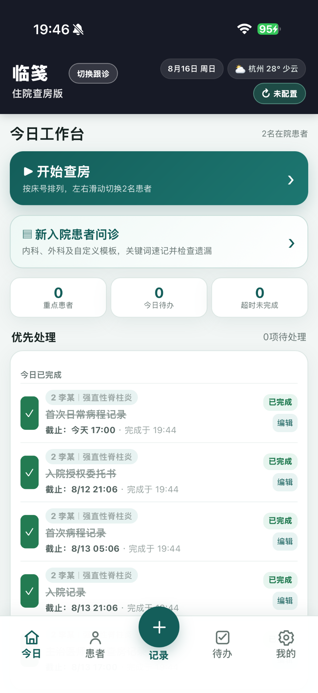
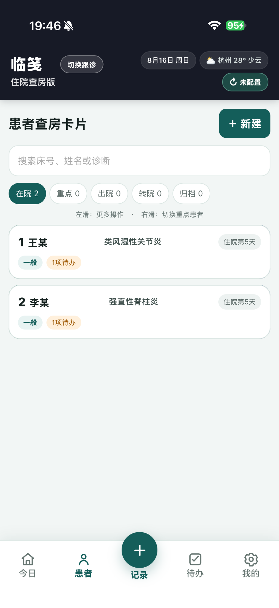
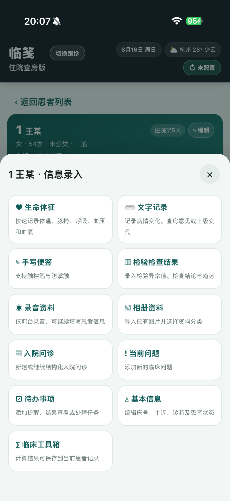
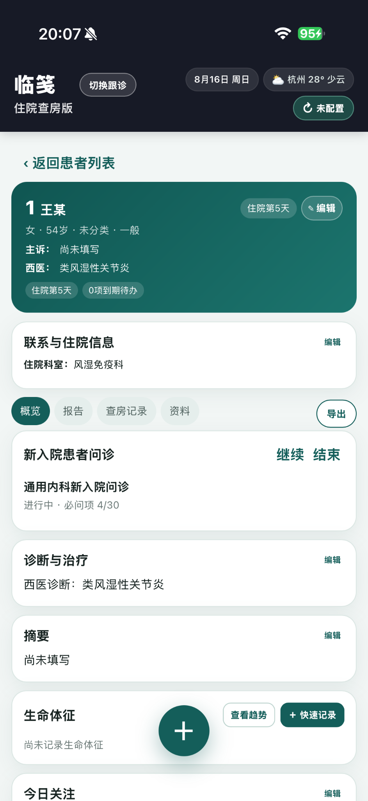
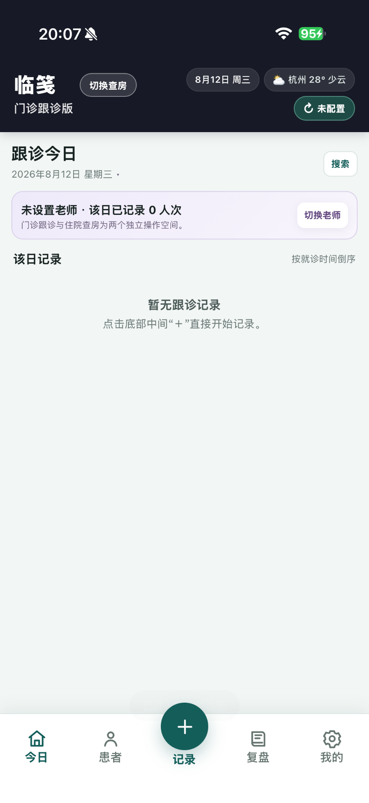
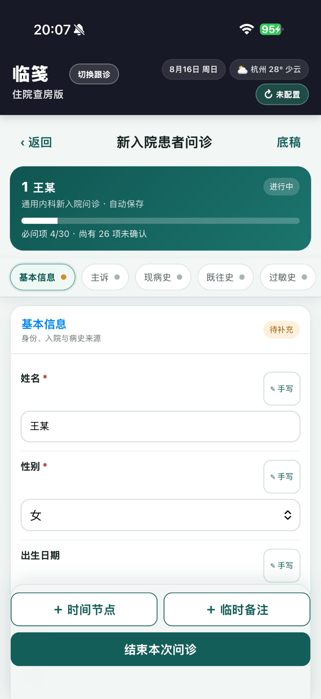

# 临笺 · Linjian

**临床查房与跟诊记录助手**

让查房重点、检验检查、待办与临床资料更集中、更清晰。

[官方网站](https://lhzspace.com/linjian/) · [使用说明](https://lhzspace.com/linjian/guide/) · [支持与联系](https://lhzspace.com/linjian/support/) · [问题反馈](https://github.com/luohuazheng-commits/linjian/issues)

临笺面向规培医生、住院医师等临床工作者，把住院查房、门诊跟诊与患者资料整理放在随手可用的记录工具中。日常记录默认保存在自己的设备上，也可按需配置跨设备同步。

## 看看临笺怎么用

以下图片沿用官网的 iPhone 实机界面；不同平台和版本的界面与功能，以实际使用版本为准。点击图片可查看大图。

<table>
  <tr>
    <td width="50%" valign="top">
      <h3>01 · 今日工作台</h3>
      
从当天的工作开始。查房、入院问诊、重点患者和待办集中呈现，方便先看需要优先处理的事情。

      
    </td>
    <td width="50%" valign="top">
      <h3>02 · 患者查房卡片</h3>
      
用搜索和状态筛选找到患者，从卡片查看诊断、住院天数与待办，再进入详情和查房流程。

      
    </td>
  </tr>
  <tr>
    <td width="50%" valign="top">
      <h3>03 · 多种记录方式</h3>
      
文字、图片、手写与录音各有入口。生命体征、检验检查、当前问题和待办，按临床场景快速记录。

      
    </td>
    <td width="50%" valign="top">
      <h3>04 · 患者详情</h3>
      
围绕同一位患者整理概览、报告、查房记录、资料、问诊与生命体征，回看信息时少一些来回切换。

      
    </td>
  </tr>
  <tr>
    <td width="50%" valign="top">
      <h3>05 · 门诊跟诊</h3>
      
独立于住院查房的跟诊工作空间，按就诊记录病情、舌脉、诊断、治疗与学习要点，方便后续回顾。

      
    </td>
    <td width="50%" valign="top">
      <h3>06 · 新入院问诊</h3>
      
按内科、外科或自定义模板采集资料，用快速选择与必问项进度提示，帮助整理问诊内容、检查遗漏。

      
    </td>
  </tr>
</table>

## 平台与获取

| 平台 | 当前状态 | 获取信息 |
| --- | --- | --- |
| Android | 已有可用版本 | [查看官网说明](https://lhzspace.com/linjian/#download)，当前官网未提供 APK 下载入口 |
| iOS / iPadOS | 正式版准备中 | App Store 与 TestFlight 入口开放后将在官网公布 |

安装、授权和各平台的具体功能范围，以对应版本说明为准。

## 数据由你掌控

- **本机保存**：患者资料默认保存在自己的设备，不要求注册开发者运营的患者云账号。
- **按需同步**：可自主配置 WebDAV，在设备间手动执行加密双向同步；两端需使用一致的配置和同步密钥。
- **独立备份**：支持用单独设置的密码创建加密完整备份，建议定期保存到可靠位置。
- **可选应用锁**：提供六位数字应用锁。应用锁限制界面访问，不等同于用 PIN 加密本地数据库。

请按所在医疗机构的要求管理患者资料、录音、截图和导出文件。临笺用于临床记录与资料整理，不替代医院信息系统、正式病历系统或专业诊疗判断。

## 使用说明与支持

- [使用说明](https://lhzspace.com/linjian/guide/)：查房、跟诊、问诊、同步和备份等功能说明。
- [支持与联系](https://lhzspace.com/linjian/support/)：常见问题、功能建议与联系方式。
- [隐私政策](https://lhzspace.com/linjian/privacy/) · [用户协议](https://lhzspace.com/linjian/terms/) · [医疗使用声明](https://lhzspace.com/linjian/medical/)

也欢迎通过 [GitHub Issues](https://github.com/luohuazheng-commits/linjian/issues) 反馈问题。请附上平台、应用版本、设备型号、复现步骤及期望结果；示例和截图请使用虚构或已脱敏资料。

## 关于本仓库

本仓库用于临笺的项目介绍、功能展示和问题反馈。公开介绍不代表应用源码已开源，源码授权以权利人明确发布的许可为准。

截图与产品信息来自 [临笺官网](https://lhzspace.com/linjian/)。

制作：LHZ · [LHZ SPACE](https://lhzspace.com/)
